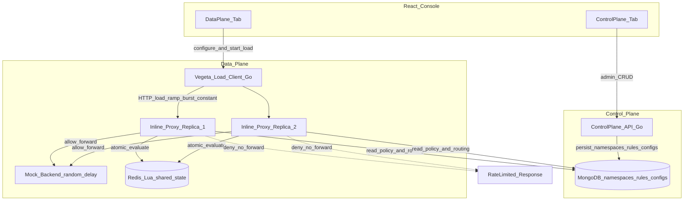

# Architecture — Distributed Rate Limiter

## Language & Technology Choices

| Layer | Choice | Role |
|-------|--------|------|
| Control plane API | **Go** | Admin config APIs: keys, paths, upstreams, rate-limit policies |
| Data plane proxy | **Go** | Inline reverse proxy; server-side rate limiting before forwarding |
| Load generator | **Go (Vegeta)** | Configurable ramp / burst / constant load against the proxy |
| Mock upstream | **Go** | Simple mock APIs with random delay (no auth) |
| Console UI | **React** | Single UI; Control Plane and Data Plane tabs |
| Policy / config store | **MongoDB** | Durable namespaces, rules, algorithm configs (document model) |
| Shared runtime state | **Redis + Lua** | Atomic quota counters across proxy instances |
| Local bootstrap | **Docker Compose** | MongoDB, Redis, ≥2 proxy replicas, control plane, mock upstream, UI |

### Why this split

- **MongoDB** owns *what the limit is* and *how traffic is matched* (namespaces, polymorphic rules, algorithm configs). Loose document shapes fit header/path/regex matchers without schema migrations.
- **Redis + Lua** owns *how much has been consumed*. All proxy replicas evaluate against the same counters under contention.
- **Control plane** mutates config; **data plane** enforces it on the request path. Auth is explicitly out of scope.

Schema detail: [`ratelimiter-schema.md`](ratelimiter-schema.md).

---

## Architecture Setup

The system is split into a **control plane** (configure) and a **data plane** (enforce + validate). One React console serves both, separated by tabs.

### 1) Control Plane

Admin surface for rate-limiter configuration. All durable config is written here and read by the data plane at evaluation time.

| Component | Responsibility |
|-----------|----------------|
| **React UI — Control Plane tab** | Operator console for CRUD on keys, paths, upstreams, and rate-limit rules; view registration state |
| **Control Plane API (Go)** | REST admin APIs backing the UI; validates and persists config |
| **MongoDB** | Source of truth for namespaces, match rules, upstream targets, and algorithm configs |

**Registrations managed here**

- **Key** — tenant / client identifier used as the rate-limit subject
- **Path** — request path (or namespace) the limit applies to
- **Upstream** — backend target the proxy forwards allowed traffic to

No request forwarding or load generation happens on this plane.

### 2) Data Plane

Request path and validation tooling. The proxy sits **inline** as a reverse proxy: rate-limit decision first, then forward to the mock (or registered) upstream. **No authentication** — auth scope is intentionally excluded.

| Component | Responsibility |
|-----------|----------------|
| **React UI — Data Plane tab** | Configure and trigger Vegeta load profiles; observe allow/deny / quota signals from runs |
| **Inline reverse proxy (Go)** | Receives client traffic; evaluates rate limit (Redis/Lua); allows → forward upstream, denies → reject with quota headers/body |
| **Proxy replicas (≥2)** | Horizontally scaled identical proxies sharing Redis state for multi-instance correctness |
| **Vegeta load client (Go)** | Configurable generator: **ramp**, **burst**, and **constant** load flavors to validate enforcement |
| **Mock backend server (Go)** | Dummy APIs with **random delay**; stands in for a real upstream so limiting behavior is observable without business logic |

### Shared infrastructure

| Component | Responsibility |
|-----------|----------------|
| **Redis + Lua** | Shared counters / token state; atomic check-and-consume across proxy instances |
| **MongoDB** | Read by data plane for active namespaces + rules + configs (cached) |
| **Docker Compose** | Local bootstrap of all components above |

---

## Component Diagram



**Separation summary**

- Left / top (**control plane**): UI Control tab → Control Plane API → MongoDB only.
- Right / bottom (**data plane**): UI Data tab → Vegeta → Proxy replicas → Redis (decide) + Mongo (config read) → Mock upstream on allow.
- Planes meet only at **MongoDB** (config) and operationally via the operator using one UI with two tabs. Proxies never expose admin mutation APIs on the hot path.

---

## Clients and Functionality

| Client | Plane | Functionality |
|--------|-------|----------------|
| **React Console — Control Plane tab** | Control | Register and manage **keys**, **paths**, **upstreams**, and rate-limit policies; browse current config |
| **React Console — Data Plane tab** | Data | Select load flavor (**ramp** / **burst** / **constant**), start/stop Vegeta runs, inspect enforcement outcomes |
| **Control Plane API** | Control | Admin REST for namespace / rule / config CRUD; sole writer to MongoDB |
| **Vegeta load client** | Data | Programmatic HTTP load generator aimed at the proxy; validates limits under sustained, spiked, and ramped traffic |
| **Inline reverse proxy** | Data | Server-side rate limiting inline; allow → proxy to upstream; deny → return limit response; multi-instance via Redis/Lua |
| **Mock backend** | Data | Target upstream with simple mock routes and random latency; no auth; used to prove forward-on-allow behavior |

---

## Explicit non-goals (current scope)

- Authentication / authorization on either plane
- Real third-party upstreams (mock only for local validation)
- Adaptive limits and DigitalOcean deploy (extensions later)

---

## Rate limiter implementation plan

Sandbox (mock, vegeta, console UI) is ready. Build the limiter in thin vertical slices.

### Locked defaults (interview slice)

| Decision | Choice | Why |
|----------|--------|-----|
| Algorithms | **fixed_token**, **fixed_window**, **sliding_window** | Catalog in Mongo; Lua per algorithm |
| Match model | **namespaces** + **rules** (`header` / `path` / `path_attr` / `method` / `regex`) | Flexible subjects without SQL join sprawl |
| Config store | **MongoDB** | Polymorphic rules + algorithm params |
| Hot state | **Redis + Lua** | Atomic check-and-consume across ≥2 proxy replicas |
| Fail mode | Fail-closed on Redis errors (deny) | Safer demo default; log clearly |

Schema: [`ratelimiter-schema.md`](ratelimiter-schema.md).

### Slice order

1. **Infra** — MongoDB + Redis on `st_net`
2. **Schema + seed** — algorithms / demo namespace + rules (control-plane boot or mongo-init)
3. **Control plane API** — CRUD for namespaces, rules, algorithm_configs
4. **Policy cache** — proxy loads active namespaces+rules (poll or invalidate)
5. **Lua evaluate** — fixed_token / fixed_window / sliding_window
6. **Inline proxy** — match rules → Lua → allow forward / 429
7. **Multi-replica** — scale proxy to 2; shared Redis under vegeta burst
8. **UI Control Plane** — wire admin forms
9. **Point vegeta** — `RATE_LIMITER_URL=http://rate-limiter:8080`

### Redis key sketch

```
rl:{algorithm}:{namespaceId}:{subject}
```

### Mongo ownership

- **Control plane** is the only writer.
- **Data plane** reads namespaces / rules / configs (cached); never mutates Mongo on the request path.

### Success criteria for the demo

- Steady under limit → high success, mock logs show forwards
- Burst over `burst` → 429s appear; latency matrix + status codes in vegeta history
- Two proxies → same limits (no double quota)
