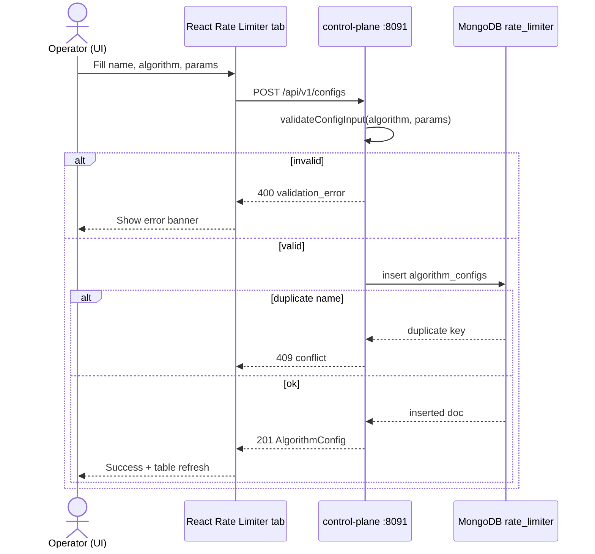
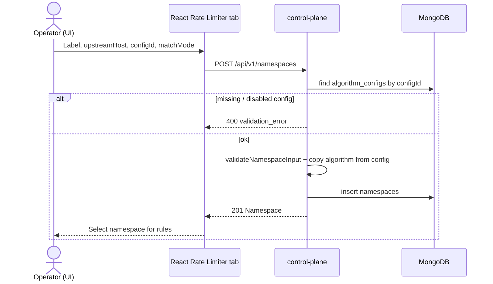
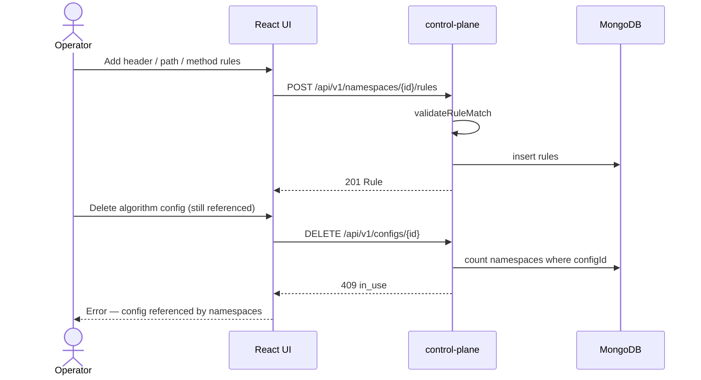
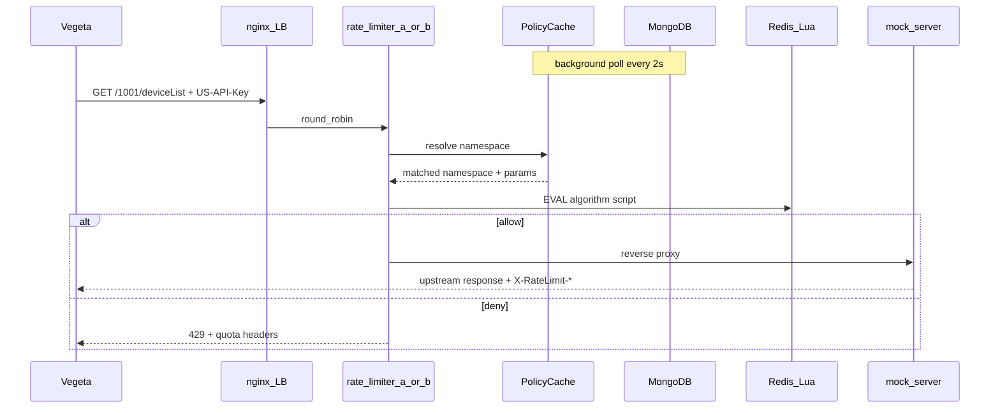

# Rate limiter — MongoDB schema

This document is the **source of truth** for control-plane data stored in MongoDB.

| Concern | Store |
|---------|--------|
| What to limit, how to match, where to forward | **MongoDB** (`rate_limiter` database) |
| How much quota has been consumed | **Redis + Lua** (not in this schema) |

- **Control plane API** — sole writer to MongoDB  
- **Data plane proxy** — read-only (cached snapshots); never mutates Mongo on the request path  
- Seed on first volume init: [`build/mongo/001_seed.js`](build/mongo/001_seed.js)

**Local connection**

| | |
|--|--|
| Host (browser / host tools) | `mongodb://localhost:27017` |
| In-network (`st_net`) | `mongo:27017` |
| Database | `rate_limiter` |
| Auth (demo) | root / `stroot` (`admin` auth DB) |

```bash
docker exec -it st-mongo mongosh -u root -p stroot --authenticationDatabase admin rate_limiter
```

---

## Mental model

```
algorithms                # catalog: sliding_window | fixed_token | fixed_window
       ▲
algorithm_configs         # reusable knobs (params); algorithm → algorithms._id
       ▲
namespaces.configId ──────┘
       ▲
rules.namespaceId         # matchers: header | path | path_attr | method | regex
```

1. A **namespace** says: *upstream + optional path + which algorithm/config*.  
2. **Rules** say: *when does a request belong to that namespace?*  
3. **algorithm_configs** hold the numeric knobs; **algorithms** describe allowed shapes.

---

## Collections

| Collection | Purpose |
|------------|---------|
| `algorithms` | Static catalog of supported rate-limit algorithms |
| `algorithm_configs` | Named, reusable parameter sets (pointer target for namespaces) |
| `namespaces` | Routing target + algorithm binding + match mode / priority |
| `rules` | Request matchers bound to a namespace |

---

## 1. `algorithms`

Catalog only. Not per-tenant. Seeded; rarely updated at runtime.

### Document shape

| Field | Type | Required | Description |
|-------|------|----------|-------------|
| `_id` | `string` | yes | Stable algorithm key (PK) |
| `label` | `string` | yes | UI display name |
| `description` | `string` | no | Operator-facing help text |
| `paramsSchema` | `object` | yes | Declares allowed keys under `algorithm_configs.params` |
| `enabled` | `bool` | yes | If false, UI/API must not create new configs with this algorithm |

```js
{
  _id: "fixed_token",
  label: "Fixed token (token bucket)",
  description: "Refill at sustained RPS; burst capacity for spikes.",
  paramsSchema: {
    sustainedRps: { type: "int", min: 1, required: true },
    burst:        { type: "int", min: 1, required: true }
  },
  enabled: true
}
```

### Seeded algorithms

| `_id` | Label | Behaviour (data plane / Redis) |
|-------|-------|--------------------------------|
| `sliding_window` | Sliding window | Count requests with timestamps in the last `windowSeconds` |
| `fixed_token` | Fixed token (token bucket) | Refill at `sustainedRps`; allow spikes up to `burst` |
| `fixed_window` | Fixed window | Hard count per discrete window of `windowSeconds` |

### Indexes

```js
db.algorithms.createIndex({ enabled: 1 })
```

---

## 2. `algorithm_configs`

Concrete knobs. Namespaces reference these via `configId` so you can swap limits without rewriting routing.

### Document shape

| Field | Type | Required | Description |
|-------|------|----------|-------------|
| `_id` | `ObjectId` | yes | PK |
| `name` | `string` | yes | Unique display / lookup name |
| `algorithm` | `string` | yes | Must equal an `algorithms._id` |
| `params` | `object` | yes | Shape depends on `algorithm` (see below) |
| `enabled` | `bool` | yes | Disabled configs must not be selected by the proxy |
| `createdAt` | `Date` | yes | |
| `updatedAt` | `Date` | yes | |

```js
{
  _id: ObjectId("65f0…"),
  name: "demo-fixed-token-10-20",
  algorithm: "fixed_token",
  params: { sustainedRps: 10, burst: 20 },
  enabled: true,
  createdAt: ISODate("…"),
  updatedAt: ISODate("…")
}
```

### `params` by algorithm

**`fixed_token`**

| Key | Type | Meaning |
|-----|------|---------|
| `sustainedRps` | int ≥ 1 | Steady refill rate (tokens / second) |
| `burst` | int ≥ 1 | Max tokens (bucket capacity) |

```js
{ sustainedRps: 10, burst: 20 }
```

**`fixed_window`**

| Key | Type | Meaning |
|-----|------|---------|
| `limit` | int ≥ 1 | Max requests per window |
| `windowSeconds` | int ≥ 1 | Window length |

```js
{ limit: 10, windowSeconds: 1 }
```

**`sliding_window`**

| Key | Type | Meaning |
|-----|------|---------|
| `limit` | int ≥ 1 | Max requests in the rolling window |
| `windowSeconds` | int ≥ 1 | Rolling window length |

```js
{ limit: 10, windowSeconds: 1 }
```

### Validation rules (control plane)

- `algorithm` must exist in `algorithms` and `enabled: true`
- `params` keys must match that algorithm’s `paramsSchema`
- Changing `algorithm` on an existing config requires rewriting `params`
- Namespaces that point at a config should keep `namespace.algorithm === config.algorithm` (denormalized); control plane updates both on write

### Indexes

```js
db.algorithm_configs.createIndex({ name: 1 }, { unique: true })
db.algorithm_configs.createIndex({ algorithm: 1, enabled: 1 })
```

---

## 3. `namespaces`

One namespace = **where allowed traffic goes** + **which limit applies**.

### Document shape

| Field | Type | Required | Description |
|-------|------|----------|-------------|
| `_id` | `ObjectId` | yes | Namespace id (PK) |
| `label` | `string` | yes | Unique human name (Control Plane UI) |
| `upstreamHost` | `string` | yes | Absolute upstream base URL (e.g. `http://mock-server:8081`) |
| `path` | `string \| null` | no | Optional forward path. `null` / omitted ⇒ use request path as received |
| `algorithm` | `string` | yes | Denormalized copy of linked config’s algorithm |
| `configId` | `ObjectId` | yes | → `algorithm_configs._id` |
| `matchMode` | `"all" \| "any"` | yes | How this namespace’s rules combine (default `"all"`) |
| `priority` | `int` | no | Lower wins if multiple namespaces match (default `100`) |
| `enabled` | `bool` | yes | |
| `createdAt` | `Date` | yes | |
| `updatedAt` | `Date` | yes | |

```js
{
  _id: ObjectId("65f1…"),
  label: "demo-deviceList",
  upstreamHost: "http://mock-server:8081",
  path: null,
  algorithm: "fixed_token",
  configId: ObjectId("65f0…"),
  matchMode: "all",
  priority: 10,
  enabled: true,
  createdAt: ISODate("…"),
  updatedAt: ISODate("…")
}
```

### Field notes

- **`upstreamHost`** — compose DNS name on `st_net` for local demos; later a real upstream.  
- **`path`** — if set, proxy may forward to `upstreamHost + path` or replace the matched path (exact forward semantics locked in the proxy slice).  
- **`matchMode`**  
  - `"all"` — every enabled rule for this namespace must match (AND)  
  - `"any"` — at least one enabled rule must match (OR)  
- **`priority`** — used only when more than one namespace matches the same request.

### Indexes

```js
db.namespaces.createIndex({ label: 1 }, { unique: true })
db.namespaces.createIndex({ enabled: 1, priority: 1 })
db.namespaces.createIndex({ configId: 1 })
```

---

## 4. `rules`

A rule answers: **does this request select namespace N?**

### Document shape

| Field | Type | Required | Description |
|-------|------|----------|-------------|
| `_id` | `ObjectId` | yes | PK |
| `namespaceId` | `ObjectId` | yes | → `namespaces._id` |
| `label` | `string` | no | UI / debug label |
| `enabled` | `bool` | yes | |
| `match` | `object` | yes | Discriminated by `match.kind` |
| `createdAt` | `Date` | yes | |
| `updatedAt` | `Date` | yes | |

```js
{
  _id: ObjectId("65f2…"),
  namespaceId: ObjectId("65f1…"),
  label: "US-API-Key demo",
  enabled: true,
  match: {
    kind: "header",
    name: "US-API-Key",
    op: "eq",
    value: "ak_demo_1001_alpha"
  },
  createdAt: ISODate("…"),
  updatedAt: ISODate("…")
}
```

### `match.kind` variants

#### `header`

| Field | Type | Required | Description |
|-------|------|----------|-------------|
| `kind` | `"header"` | yes | |
| `name` | `string` | yes | Header name (compare case-insensitive at evaluate time) |
| `op` | `"eq" \| "in"` | yes | |
| `value` | `string` | if `op=eq` | Exact value |
| `values` | `string[]` | if `op=in` | Membership |

```js
{ kind: "header", name: "US-API-Key", op: "eq", value: "ak_demo_1001_alpha" }
```

```js
{ kind: "header", name: "US-API-Key", op: "in", values: ["ak_a", "ak_b"] }
```

#### `path`

| Field | Type | Required | Description |
|-------|------|----------|-------------|
| `kind` | `"path"` | yes | |
| `op` | `"eq" \| "prefix"` | yes | |
| `value` | `string` | yes | Request URL path |

```js
{ kind: "path", op: "eq", value: "/1001/deviceList" }
```

```js
{ kind: "path", op: "prefix", value: "/1001/" }
```

#### `path_attr` (tenant / path attribute)

Extract a named capture or segment from the path, then compare.

| Field | Type | Required | Description |
|-------|------|----------|-------------|
| `kind` | `"path_attr"` | yes | |
| `pattern` | `string` | yes | Regex with a named group (RE2 / Go-compatible in proxy) |
| `attr` | `string` | yes | Capture name to read |
| `op` | `"eq" \| "in"` | yes | |
| `value` / `values` | string / string[] | yes | Expected attribute value(s) |

```js
{
  kind: "path_attr",
  pattern: "^/(?P<tenantId>[0-9]+)/deviceList$",
  attr: "tenantId",
  op: "eq",
  value: "1001"
}
```

#### `method`

| Field | Type | Required | Description |
|-------|------|----------|-------------|
| `kind` | `"method"` | yes | |
| `op` | `"eq" \| "in"` | yes | |
| `value` / `values` | string / string[] | yes | HTTP method(s), uppercase |

```js
{ kind: "method", op: "eq", value: "GET" }
```

#### `regex`

| Field | Type | Required | Description |
|-------|------|----------|-------------|
| `kind` | `"regex"` | yes | |
| `field` | `"path" \| "full"` | yes | `full` = `"METHOD path"` |
| `pattern` | `string` | yes | Regex |

```js
{ kind: "regex", field: "path", pattern: "^/1001/.*$" }
```

### Indexes

```js
db.rules.createIndex({ namespaceId: 1, enabled: 1 })
db.rules.createIndex({ "match.kind": 1, "match.name": 1 })
```

---

## Data-plane evaluation

1. Load enabled namespaces + rules + resolve `algorithm_configs` (cache; TTL or control-plane invalidation).  
2. For each request, test each enabled namespace’s rules with `matchMode` (`all` / `any`).  
3. **No match** — lock behaviour in proxy slice (recommended demo: `404`/`403` if any namespaces exist; open allow only on empty config).  
4. **Multiple matches** — lowest `priority` wins; tie-break by specificity: `header` > `path_attr` > `path` > `regex` > `method`.  
5. Build Redis subject from identity (header value, tenant attr, or path).  
6. Run Lua for `namespace.algorithm` + `config.params`.  
7. **Allow** → forward to `upstreamHost` (+ optional `path`). **Deny** → `429` + quota headers.

### Redis key sketch

Full Redis/Lua detail: [`redis-schema.md`](redis-schema.md).

```
rl:{algorithm}:{namespaceId}:{subject}
```

Examples of `{subject}`:

- `hdr:US-API-Key:ak_demo_1001_alpha`
- `tenant:1001`
- `path:/1001/deviceList`

---

## Demo seed (aligned with vegeta + mock)

Applied by [`build/mongo/001_seed.js`](build/mongo/001_seed.js) on first Mongo volume init.

| Artifact | Value |
|----------|--------|
| Config | `demo-fixed-token-10-20` → `fixed_token`, 10 rps, burst 20 |
| Namespace | `demo-deviceList` → `http://mock-server:8081`, `matchMode: "all"`, priority `10` |
| Rules (AND) | header `US-API-Key=ak_demo_1001_alpha` ∧ path `/1001/deviceList` ∧ method `GET` |

```js
// conceptual seed
algorithms: [sliding_window, fixed_token, fixed_window]

algorithm_configs: {
  name: "demo-fixed-token-10-20",
  algorithm: "fixed_token",
  params: { sustainedRps: 10, burst: 20 }
}

namespaces: {
  label: "demo-deviceList",
  upstreamHost: "http://mock-server:8081",
  path: null,
  algorithm: "fixed_token",
  configId: <config>,
  matchMode: "all",
  priority: 10
}

rules: [
  { match: { kind: "header", name: "US-API-Key", op: "eq", value: "ak_demo_1001_alpha" } },
  { match: { kind: "path", op: "eq", value: "/1001/deviceList" } },
  { match: { kind: "method", op: "eq", value: "GET" } }
]
```

Verify:

```bash
docker exec st-mongo mongosh -u root -p stroot --authenticationDatabase admin rate_limiter --eval \
  'db.namespaces.find().toArray(); db.rules.find().toArray()'
```

---

## Ownership matrix

| Actor | Mongo access | Redis access |
|-------|----------------|--------------|
| Control plane API | Read / write all four collections | None |
| Rate-limiter proxies (`a`/`b`) | Read-only (2s policy cache) | Read/write via Lua (consume + peek) |
| Vegeta client | None | None |
| Mock backend | None | None |
| React console | Via control plane API only | Via `GET /api/v1/quota` on proxy LB |

---

## Out of scope (this schema)

- Authentication / authorization on admin APIs  
- Soft deletes / revision history (add `revisions` later if needed)  
- Cross-document transactions beyond single-namespace CRUD bundles  
- Storing Redis counters or request logs in Mongo  

---

## Control plane API

Service: `control-plane` · host `http://localhost:8091` · network `http://control-plane:8091`

| Method | Path | Purpose |
|--------|------|---------|
| `GET` | `/healthz` | Liveness |
| `GET` | `/api/v1/algorithms` | Algorithm catalog |
| `GET` | `/api/v1/configs` | List algorithm configs |
| `POST` | `/api/v1/configs` | Create config |
| `GET` | `/api/v1/configs/{id}` | Get config |
| `PUT` | `/api/v1/configs/{id}` | Update config |
| `DELETE` | `/api/v1/configs/{id}` | Delete (fails if namespaces reference it) |
| `GET` | `/api/v1/namespaces` | List namespaces |
| `POST` | `/api/v1/namespaces` | Create namespace |
| `GET` | `/api/v1/namespaces/{id}` | Get namespace |
| `PUT` | `/api/v1/namespaces/{id}` | Update namespace |
| `DELETE` | `/api/v1/namespaces/{id}` | Delete namespace + cascade rules |
| `GET` | `/api/v1/namespaces/{id}/rules` | List rules |
| `POST` | `/api/v1/namespaces/{id}/rules` | Create rule |
| `PUT` | `/api/v1/rules/{id}` | Update rule |
| `DELETE` | `/api/v1/rules/{id}` | Delete rule |
| `GET` | `/api/v1/tests/catalog` | List runnable test suites |
| `POST` | `/api/v1/tests/run?suite=unit\|functional\|concurrency\|e2e\|all` | Execute suites; each case includes description, assertions, request/response, steps |

**Suites**

| Suite | What it covers |
|-------|----------------|
| `unit` | Validators + isolated in-memory HTTP API |
| `functional` | Live store CRUD, conflicts, in-use guards |
| `concurrency` | Parallel writers / duplicate-name races |
| `e2e` | Control-plane write → proxy poll → quota / allow / 429, plus scenarios: dual API-key configs (same tenant), tenant-id single/multi key, per-path limits (needs `RATE_LIMITER_URL`; skips if proxy unreachable or Mongo not shared) |
| `all` | unit → functional → concurrency → e2e |

E2E uses `RATE_LIMITER_URL` (default `http://localhost:8080` on host, `http://rate-limiter:8080` in compose) and waits ~`3 × POLICY_POLL_INTERVAL` for the proxy policy cache.

Errors return `{ "error": "...", "code": "validation_error|not_found|conflict|..." }`.

Console **Testing** tab calls `POST /api/v1/tests/run` and renders the report table (including skipped e2e cases).

---

## Data plane API (rate-limiter)

Service: nginx LB `rate-limiter` · host `http://localhost:8080` · network `http://rate-limiter:8080`  
Replicas: `rate-limiter-a` / `rate-limiter-b` (same routes; shared Redis).  
Redis detail: [`redis-schema.md`](redis-schema.md).

| Method | Path | Purpose |
|--------|------|---------|
| `GET` | `/healthz` | Liveness (`{"status":"ok","instance":"a\|b"}`) |
| `GET` | `/api/v1/quota` | **Observable quota** — peek remaining / consumed / reset (does **not** consume) |
| `GET` | `/api/v1/tests/catalog` | List data-plane test suites (`unit`, `functional`, `all`) |
| `POST` | `/api/v1/tests/run?suite=unit\|functional\|all` | Execute matcher / Lua / live Redis suites; same report shape as control-plane |
| `*` | `/*` | Inline proxy: match rules → Redis Lua → allow forward upstream or `429` |

**Data-plane suites** (Console **Testing** → Data plane)

| Suite | What it covers |
|-------|----------------|
| `unit` | Matcher specificity, subjects, policy-cache swap, algorithms on isolated miniredis |
| `functional` | Live Redis evaluate/peek, healthz/quota HTTP, match against loaded policy (skips when empty) |
| `all` | unit → functional |

### `GET /api/v1/quota`

Peek current Redis quota for an identifier in a namespace. Does not decrement tokens / counters.

**Query params** (need `namespace` plus one identity form):

| Param | Required | Meaning |
|-------|----------|---------|
| `namespace` | yes | Namespace **id** (hex) or **label** (e.g. `demo-deviceList`) |
| `namespaceId` | alt | Same as `namespace` |
| `subject` | one of | Full Redis subject, e.g. `hdr:US-API-Key:ak_demo_1001_alpha` |
| `apiKey` | one of | Shorthand → subject `hdr:US-API-Key:{apiKey}` |
| `header` + `value` | one of | Shorthand → `hdr:{header}:{value}` |
| `tenant` | one of | Shorthand → `tenant:{tenant}` |
| `path` | one of | Shorthand → `path:{path}` |

```bash
curl -sS 'http://localhost:8080/api/v1/quota?namespace=demo-deviceList&apiKey=ak_demo_1001_alpha'
```

**Example response**

```json
{
  "namespaceId": "6adb0f30d436ed6d1d76c931",
  "namespace": "demo-deviceList",
  "algorithm": "fixed_token",
  "subject": "hdr:US-API-Key:ak_demo_1001_alpha",
  "redisKey": "rl:fixed_token:6adb0f30d436ed6d1d76c931:hdr:US-API-Key:ak_demo_1001_alpha",
  "limit": 20,
  "remaining": 17,
  "consumed": 3,
  "resetMs": 100,
  "resetAt": "2026-10-23T08:10:05.656Z",
  "observedAt": "2026-10-23T08:10:05.556Z",
  "params": { "sustainedRps": 10, "burst": 20 }
}
```

| Status | When |
|--------|------|
| `200` | Peek succeeded |
| `400` | Missing `namespace` or identity |
| `404` | Namespace not found / disabled |
| `502` | Redis peek failed |
| `503` | Policy cache not loaded |

On the **enforce** path (any non-quota request), allow/deny also returns quota via headers: `X-RateLimit-Limit`, `X-RateLimit-Remaining`, `X-RateLimit-Reset`, plus `X-Proxy-Instance`.

---

## Sequence diagrams

### Create algorithm config (UI → API → Mongo)



### Create namespace bound to a config



### Attach match rules then delete config (guard)



### Runtime read path (proxy — implemented)

Full end-to-end diagrams: [`sequences.md`](sequences.md).



---

## Related docs

- [`architecture.md`](architecture.md) — planes, compose topology, implementation slices  
- [`redis-schema.md`](redis-schema.md) — Redis keys + Lua consume/peek  
- [`sequences.md`](sequences.md) — end-to-end client / operator sequences  
- [`README.md`](README.md) — bootstrap / ports  
- [`build/mongo/001_seed.js`](build/mongo/001_seed.js) — init seed script  

