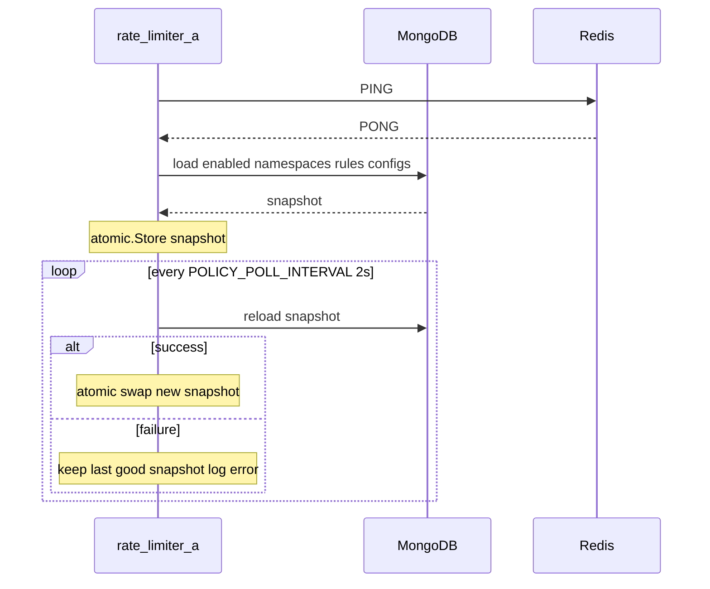
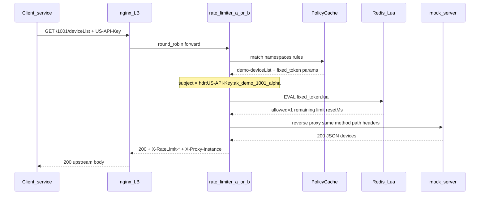
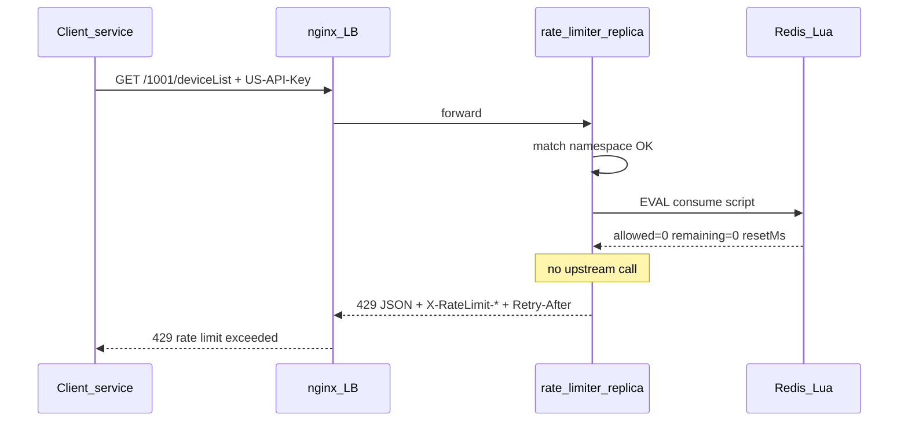
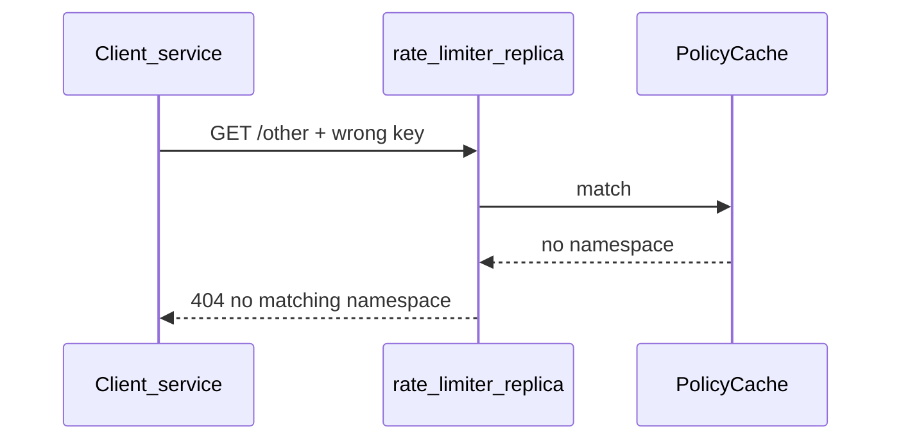
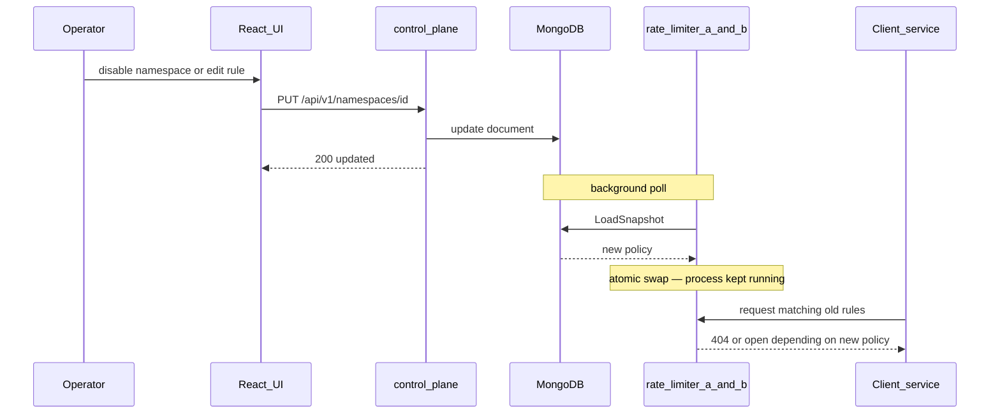
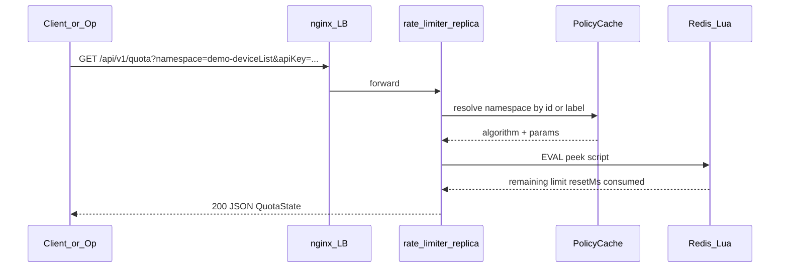
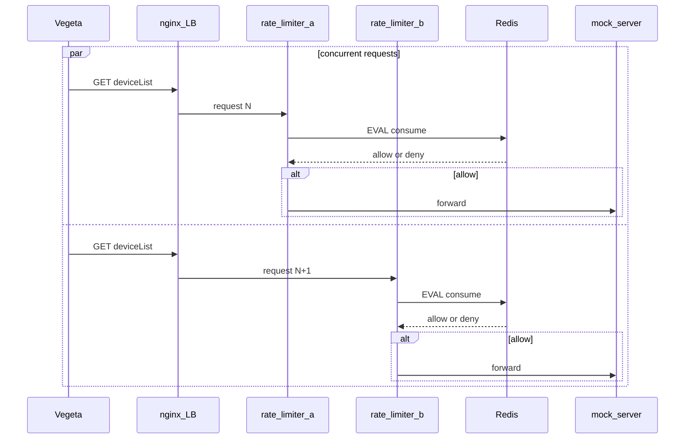
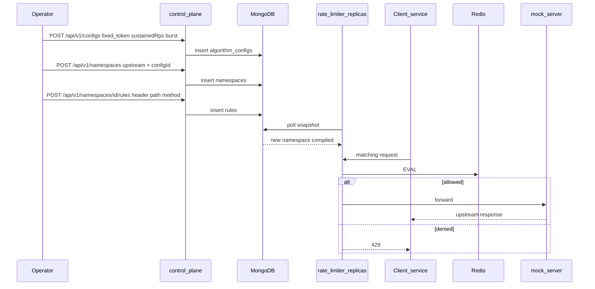
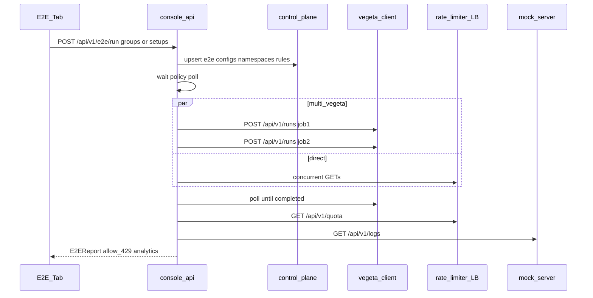

# End-to-end sequences

How the stack interacts when a **client** (or Vegeta) hits the rate limiter, and how that fits the control / data plane split.

| Doc | Role |
|-----|------|
| [`architecture.md`](architecture.md) | Component map |
| [`ratelimiter-schema.md`](ratelimiter-schema.md) | Mongo policy |
| [`redis-schema.md`](redis-schema.md) | Redis quota keys + Lua |
| **This file** | Runtime call order |

---

## Architecture fit (where the client sits)

```mermaid
flowchart LR
  subgraph clients [Clients]
    App[Client_service]
    Veg[Vegeta_loadgen]
    Op[Operator_UI]
  end

  subgraph controlPlane [Control_plane]
    CP[control_plane_API]
    Mongo[(MongoDB_policy)]
  end

  subgraph dataPlane [Data_plane]
    LB[nginx_rate_limiter]
    A[rate_limiter_a]
    B[rate_limiter_b]
    Redis[(Redis_Lua_quota)]
    Mock[mock_server_upstream]
  end

  Op -->|CRUD_rules_configs| CP
  CP -->|write_only| Mongo

  App -->|HTTP| LB
  Veg -->|HTTP_load| LB
  LB --> A
  LB --> B
  A -->|read_cache_poll| Mongo
  B -->|read_cache_poll| Mongo
  A -->|EVAL_quota| Redis
  B -->|EVAL_quota| Redis
  A -->|allow_forward| Mock
  B -->|allow_forward| Mock
```



**Planes meet only at Mongo** (policy) and **Redis** (shared counters). Clients never call Redis or Mongo directly; operators never call the proxy for config writes.

---

## 1. Cold start — policy into memory

Before the first client request, each proxy replica loads Mongo and starts the poller.



Same sequence runs independently on `rate-limiter-b`. No restart is required when Mongo policy later changes.

---

## 2. Client request — allow path

Happy path for the seeded demo: `GET /1001/deviceList` + `US-API-Key: ak_demo_1001_alpha`.



---

## 3. Client request — deny path (429)

When the bucket / window is exhausted (e.g. concurrent burst over `burst=20`).



Redis / Lua errors use the same fail-closed outcome (`429`, `X-RateLimit-Error: redis`) without forwarding.

---

## 4. No matching namespace

Enabled namespaces exist, but rules do not match (wrong key, path, or method).



If the snapshot has **zero** enabled namespaces → open response (`{"status":"open"}`) instead of enforcing.

---

## 5. Hot config change (no proxy restart)

Operator updates Mongo via control plane; proxies pick it up on the next poll (≤ ~2s).



Control plane is the **sole Mongo writer**. Proxies never mutate policy on the request path.

---

## 6. Observable quota (peek)

Client or operator inspects consumption **without** consuming a unit.



Example:

```bash
curl -sS 'http://localhost:8080/api/v1/quota?namespace=demo-deviceList&apiKey=ak_demo_1001_alpha'
```

---

## 7. Multi-instance under load (Vegeta)

Two proxies share Redis so total allows ≈ configured burst/limit, not `2 × limit`.



Response header `X-Proxy-Instance: a|b` shows which replica answered; Redis remains the single source of truth for quota.

---

## 8. Operator configures a new limit (full loop)

From empty intent → live enforcement for clients.



---

## 9. E2E automation (console-api)

UI tab **E2E** → `POST /api/v1/e2e/run` on console-api. Ensures fixtures via control-plane, drives direct and/or multi-Vegeta load, peeks quota, diffs mock logs.



---

## Timing cheat sheet

| Step | Typical latency driver |
|------|------------------------|
| Policy poll | `POLICY_POLL_INTERVAL` (default `2s`) — config lag after CRUD |
| Redis Lua | Sub-ms local; shared across replicas |
| Allow forward | Dominated by upstream (mock ~500ms demo delay) |
| Deny | Redis only — no upstream |
| E2E multi-Vegeta | Dominated by vegeta duration + mock latency |

---

## Related ports (local)

| Client talks to | URL |
|-----------------|-----|
| Enforce / peek (LB) | `http://localhost:8080` |
| Replica A / B (debug) | `http://localhost:18080` / `18081` |
| Control plane CRUD | `http://localhost:8091` |
| Vegeta control API | `http://localhost:8090` |
| Mock upstream direct | `http://localhost:8081` |
| E2E automation | `http://localhost:8095/api/v1/e2e/*` |
